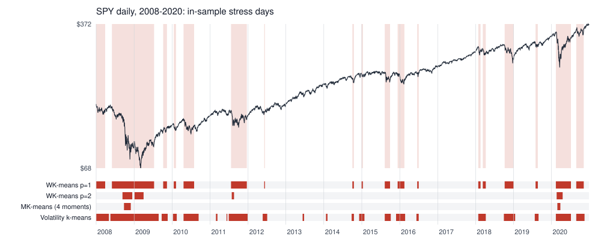
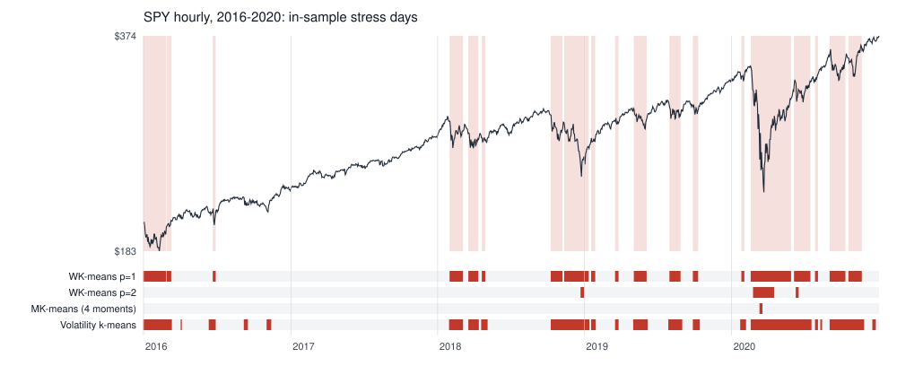

# Wasserstein k-means market regimes (#672)

**Status (2026-11-24):** part 1 of 4 done. The published clustering is implemented and replicated in sample (#673). The online fit with no look-ahead (#674), the trading test (#675) and the robustness grid (#676) are open. Reading verdicts for #677 are in [literature_and_methods.md](../02_gex_research/literature_and_methods.md#regime-detection-672-677).

**Question (#672):** does a regime label learned from the distribution of recent returns, with no fixed thresholds, improve a strategy out of sample, after costs and with no look-ahead?

**Method:** Horvath, Issa and Muguruza, "Clustering market regimes using the Wasserstein distance", *Journal of Computational Finance* (2024), doi:10.21314/JCF.2024.005; preprint arXiv:2110.11848. Returns are cut into overlapping windows, and each window is treated as the empirical distribution of its returns. k-means then runs with the p-Wasserstein distance; in one dimension that is a distance between sorted vectors, and the centroids are medians (p = 1) or means (p = 2) of sorted windows. Sorting discards the order of returns inside a window. Code: `src/backtesting/regimes/` (WK-means, moment k-means, volatility k-means, the paper's scores and synthetic paths).

## Part 1: replication (#673)

Runner: `scripts/research/wk_means_replication.py`. Results: [results/wk_means_replication.md](results/wk_means_replication.md) (tables) and [results/wk_means_replication.json](results/wk_means_replication.json), which records the commit, versions, data hashes and seeds. All of this is in sample, like the paper: a day's label uses windows that extend after it. **None of it is a trading result.**

### Synthetic paths: the paper's Tables 3 and 4

The paper's regime-switching GBM and Merton jump-diffusion paths use 20 years of hourly steps, with ten half-year "bear" intervals (25% of the returns). There are 50 paths per model, windows (35, 28) and k = 2. TA is the share of window votes that put a return in its true regime; RONS and ROFS are the same share for returns inside and outside the regime changes. The ± is the 95% CI of the mean over 50 paths. The paper labels its ± a 95% CI without defining it.

| Model | Method | TA % | RONS % | Paper TA % (RONS %) |
| --- | --- | --- | --- | --- |
| GBM | WK-means p=1, the paper's start (one random draw) | 91.4 ± 2.7 | 87.7 | 90.60 ± 5.81 (87.24) |
| GBM | WK-means p=1, k-means++, 10 restarts | 94.4 ± 0.2 | 89.7 | |
| GBM | WK-means p=2, k-means++, 10 restarts | 95.6 ± 0.1 | 89.8 | |
| GBM | MK-means, 4 moments | 93.2 ± 0.2 | 74.6 | 93.23 ± 0.41 (74.83) |
| GBM | Volatility k-means (not in the paper) | 94.2 ± 0.2 | 94.6 | |
| Merton | WK-means p=1 (either start) | 98.9 ± 0.0 | 97.0 | 91.28 ± 4.08 (86.87) |
| Merton | WK-means p=2, the paper's start | 92.0 ± 2.4 | 69.3 | |
| Merton | WK-means p=2, k-means++, 10 restarts | 78.5 ± 1.6 | 14.5 | |
| Merton | MK-means, 4 moments, the paper's start | 72.4 ± 1.8 | 13.4 | 66.64 ± 3.42 (27.25) |
| Merton | Volatility k-means (not in the paper) | 97.5 ± 0.1 | 98.2 | |

1. **MK-means replicates exactly on GBM** (93.2 against 93.23; RONS 74.6 against 74.83). On Merton it fails as the paper says, though not by the same amount (72.4 against 66.64).
2. **WK-means replicates on GBM with the paper's single random start** (91.4 against 90.60). With k-means++ and ten restarts it does better (94.4 and 95.6). The single start is unstable: on two Gaussian regimes in the tests, one random start falls as low as TA 0.63.
3. **On Merton, WK-means with p = 1 beats the published figure** (98.9 against 91.28), whatever the start.
4. **p matters, and the paper does not state it.** With p = 2 on Merton, the lowest-cost clustering isolates the windows with the largest jumps rather than the regime (TA 78.5, RONS 14.5), and the outcome depends on the start. The paper's SPY result, where WK-means flags 2010, 2011 and 2015-16 and MK-means flags only 2008 and 2020, is what p = 1 gives here. p = 2 behaves like MK-means (below).
5. **A plain volatility clustering does almost as well.** k-means on each window's log standard deviation, a baseline the paper does not run, scores within 0.2 points of WK-means p = 1 on GBM and 1.4 points on Merton. The paper's baselines are MK-means and a Gaussian HMM. Raw moments are dominated by a few extreme windows, so MK-means is a weak baseline.

Not reproduced: the paper's HMM baseline (#676), its synthetic window sizes (not stated; (35, 28) assumed), and the number of moments behind MK-means (not stated; 4 used).

### SPY, in sample

- **Daily:** 2008-01-02 to 2020-12-31, from `equity_prices_daily` (read-only; the table starts in 2008, the paper's sample in 2005). 3,273 log returns; windows (20, 15) are four weeks moved forward one week.
- **Hourly:** 2016 to 2020, the paper's frequency and windows (35, 28), one week moved forward one day. The gex database has no SPY bars before 2026, so these are Alpaca hourly bars (SIP feed, raw; Alpaca's history starts in 2016), fetched with `scripts/research/fetch_hourly_bars.py`.
  - 8,779 returns: the regular session's hourly closes, seven a day, the overnight return included. The bars sit outside the repository; the results record their hash.
  - Days and bars were checked against the database: all 1,259 trading days have 7 bars, or 4 on the 11 early closes.
  - The last regular-session close is within 0.011% of the official close (median), but never equal to it: the closing auction prints after 16:00.

A day counts as stress when most of the windows containing it are in the volatile cluster.

| Episode (dates fixed before the run) | Daily, WK-means p=1 | Daily, p=2 | Daily, MK-means | Daily, volatility k-means | Hourly, WK-means p=1 | Hourly, volatility k-means |
| --- | --- | --- | --- | --- | --- | --- |
| Financial crisis, Sep 2008-Mar 2009 | 1.00 | 0.84 | 0.31 | 1.00 | | |
| Euro debt crisis, May-Jul 2010 | 1.00 | 0.00 | 0.00 | 1.00 | | |
| US downgrade, Aug-Oct 2011 | 1.00 | 0.21 | 0.00 | 1.00 | | |
| China devaluation, Aug-Sep 2015 | 0.83 | 0.00 | 0.00 | 0.83 | | |
| China sell-off, Jan-Feb 2016 | 0.80 | 0.00 | 0.00 | 0.92 | 1.00 | 1.00 |
| Volatility spike, Feb 2018 (not named by the paper) | 0.63 | 0.00 | 0.00 | 1.00 | 1.00 | 1.00 |
| Q4 2018 sell-off (not named by the paper) | 0.92 | 0.00 | 0.00 | 1.00 | 0.86 | 0.91 |
| COVID crash, Mar-Apr 2020 | 1.00 | 0.81 | 0.47 | 1.00 | 1.00 | 1.00 |
| All other days | 0.17 | 0.00 | 0.00 | 0.27 | 0.20 | 0.28 |

Share of each episode's trading days labelled stress. "All other days" is not a false-alarm rate, since stress outside these windows can be real.





- **WK-means with p = 1 recovers every episode the paper names**, at both frequencies, and both 2018 episodes too.
  - Its stress cluster holds 32% of the daily windows, at a median annualised volatility of 22.6% against 10.1% for the calm one.
  - It labels 99.7% of the days with VIX at 30 or more as stress, and 1.2% of the days with VIX under 15.
- **With p = 2 and with MK-means, the volatile cluster is only the extremes:** 6% and 2% of the daily windows, at a median volatility of 47% and 77%. That is the 2008 and 2020 pattern the paper reports for MK-means.
- **WK-means p = 1 and volatility k-means give the same label to 90.9% of the daily windows and 93.2% of the hourly ones.**
- The hourly and daily WK-means labels agree on 88.5% of their common days.

### What part 1 changes for the rest of the study

- **The baseline WK-means must beat is volatility, not a fixed threshold.** On SPY with k = 2, WK-means is mostly a clustering on volatility. The trading test (#675) should include volatility k-means and a rolling realized-volatility threshold. A WK-means filter that does not beat them adds nothing over volatility timing.
- **p = 1, k-means++ with 10 restarts** are the settings to carry forward. They were chosen on the synthetic paths and the paper's in-sample SPY episodes, before any out-of-sample result. p = 2 depends on the start when returns have jumps, and isolates the extremes.
- **Daily windows are enough to find the episodes,** so the online version (#674) can run on the daily database series from 2008 to 2026-10-09 without the hourly bars.

### Reproduce

```bash
PY=~/miniconda3/envs/OptionsCommander/bin/python
$PY -s scripts/research/fetch_hourly_bars.py --out <folder outside the repo>   # Alpaca key via ConfigLoader
$PY -s scripts/research/wk_means_replication.py --hourly-cache <that folder>   # about 3 minutes
```

Without `--hourly-cache` the hourly part is skipped. The synthetic part needs neither the database nor a key: `--no-daily --synthetic-runs 50`.
